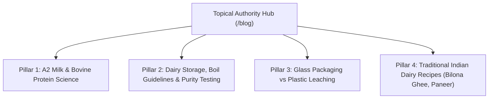

# MilQuuFresh — Content & Editorial SEO Roadmap

**Domain:** https://milquufresh.in/blog  
**Focus:** Dairy Science, Purity, Storage, Traditional Ayurvedic Nutrition & Navi Mumbai Healthy Living  
**Editorial Policy:** Strictly verified facts. No fabricated medical cures or unverified health claims.

---

## 1. Content Strategy & Topical Authority

To establish MilQuuFresh as the undisputed authority in fresh dairy in Maharashtra, the content architecture is organized into four core pillars:

---

## 2. Fact-Checking & Editorial Safety Protocol

Google's Search Quality Evaluator Guidelines hold food, nutrition, and health content to stringent **E-E-A-T (Experience, Expertise, Authoritativeness, Trustworthiness)** and **YMYL (Your Money Your Life)** standards.

### Strict Publishing Rules:
1. **No Medical Claims:** Content must NEVER claim milk or ghee "cures diabetes", "prevents cancer", or "reverses hypertension". Use accurate, compliant descriptors: *"nutrient-dense"*, *"naturally rich in calcium and protein"*, *"traditional Ayurvedic dietary inclusion"*.
2. **Editorial Status System:**
   - As implemented in `src/data/blog-posts.js`, every article has a strict status:
     - `published`: Verified facts only. Included in `sitemap.xml` and indexed.
     - `review`: Unverified claims held back. Carries `noindex, follow` robots tag until owner and dietary expert sign-off.
     - `draft`: Unreleased content. Excluded from routing.
3. **Operational Accuracy:** Shelf-life, storage temperatures, and boiling guidelines must reflect actual daily household realities.

---

## 3. 12-Month Editorial Calendar (2026–2027)

| Month | Article Title | Target Keyword | Pillar | Status |
| :--- | :--- | :--- | :--- | :--- |
| **Month 1** | *Why Glass Bottles Keep Milk Fresher and Safer Than Plastic Pouches* | `glass bottle milk benefits` | Packaging | **Published** |
| **Month 2** | *A2 Gir Cow Milk vs Regular Milk: A Clear Guide for Families* | `A2 milk vs regular milk` | Science | **Published** |
| **Month 3** | *Cow Milk vs Buffalo Milk: Which Is Right for Chai, Curd, and Health?* | `cow vs buffalo milk` | Product | **Published** |
| **Month 4** | *How to Store Raw and Pasteurized Milk at Home: Best Practices* | `how to store milk` | Practical | **Published** |
| **Month 5** | *What Is Bilona Ghee? Traditional Hand-Churned Vedic Butter Explained* | `bilona ghee benefits` | Tradition | **Published** |
| **Month 6** | *How to Spot Adulteration in Milk: Simple Tests You Can Do in Your Kitchen* | `how to test milk purity at home` | Consumer | **Published** |
| **Month 7** | *The Importance of an Unbroken Cold Chain in Morning Milk Delivery* | `cold chain milk delivery` | Operations | **Review** |
| **Month 8** | *Fresh Malai Paneer: Why Store-Bought Packaged Paneer Tastes Rubber-Like* | `fresh malai paneer vs packaged` | Product | **Draft** |
| **Month 9** | *Starting Solid Foods for Toddlers: When and How to Introduce Cow Milk* | `cow milk for toddlers guide` | Family | **Draft** |
| **Month 10**| *Setting Thick, Creamy Curd (Dahi) at Home with Buffalo Milk: The Master Guide*| `how to make thick dahi at home` | Culinary | **Draft** |
| **Month 11**| *Navi Mumbai Dairy Guide: Understanding Early Morning Distribution Hubs* | `navi mumbai dairy suppliers` | Local | **Draft** |
| **Month 12**| *A Year of Plastic-Free Mornings: Environmental Impact of Returnable Glass Bottles*| `sustainable milk subscription` | Eco/USP | **Draft** |

---

## 4. Article Anatomy & Internal Linking Template

Every published article must strictly incorporate:
1. **Title:** Engaging, search-optimized, under 65 characters.
2. **Meta Description:** Clear summary with call-to-action (130–160 characters).
3. **Author Byline:** `"MilQuuFresh Dairy Research Team"`.
4. **Structured Data:** `BlogPosting` Schema + `BreadcrumbList` Schema + `FAQPage` Schema.
5. **Internal Links (Minimum 3):**
   - At least 1 link to a related Product Page (e.g. `/product/farm-fresh-cow-milk`).
   - At least 1 link to the Subscription Page (`/subscribe`).
   - At least 1 link to the Regional Delivery Hub (`/milk-delivery-navi-mumbai`).
6. **Bottom Conversion Block:** Soft conversion prompt linking to morning subscriptions or WhatsApp chat.
