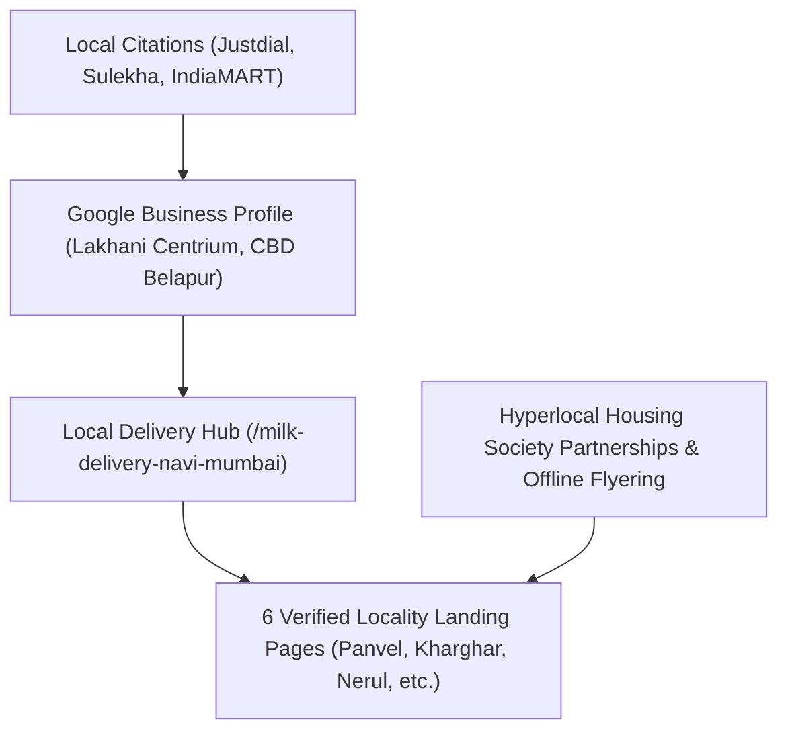

# MilQuuFresh — Hyperlocal Local SEO Strategy

**Primary Market:** Navi Mumbai, Maharashtra  
**Service Localities:** Panvel, New Panvel, Karanjade, Kharghar, CBD Belapur, Nerul, Kamothe, Taloja  
**Goal:** Dominance in Google 3-Pack Map Results and Top-3 Local Organic Rankings.

---

## 1. Local Search Ecosystem Architecture

Local SEO for dairy delivery is driven by high-proximity, repeat-purchase customer intent. Customers looking for milk delivery search with strong geographical qualifiers (e.g. *"milk delivery in kharghar sector 20"*, *"A2 milk near me"*).

---

## 2. Locality Architecture: Verified vs Unverified Areas

### The Strict Locality Rule
In accordance with project constraints, **MilQuuFresh only promotes areas explicitly verified in `backend/config/serviceAreas.js`**.
1. **Verified Areas with Dedicated Landing Pages:**
   - Panvel (`/milk-delivery-panvel`)
   - New Panvel (`/milk-delivery-new-panvel`)
   - Karanjade (`/milk-delivery-karanjade`)
   - Kharghar (`/organic-milk-kharghar`)
   - CBD Belapur (`/fresh-cow-milk-belapur`)
   - Nerul (`/farm-fresh-milk-nerul`)
2. **Verified Areas Supported via Hub & Chips:**
   - Kamothe and Taloja (highlighted on the main delivery hub, product pages, and checkout, without thin duplicate doorway pages).
3. **Unverified Areas (STRICTLY FORBIDDEN):**
   - Vashi, Airoli, Ghansoli, Kopar Khairane, Sanpada, Seawoods.
   - *Rationale:* Publishing landing pages for areas where delivery cannot be guaranteed burns organic trust, inflates bounce rates, frustrates potential customers, and invites Google thin-content / doorway algorithmic penalties.

---

## 3. Avoiding Google Doorway Page Penalties

Google's spam guidelines strictly penalize "doorway pages" — large collections of near-identical pages created purely to funnel searchers into one generic site.

To prevent this:
1. **Distinct Semantic Content per Page:**
   - Each locality page features localized delivery timings (e.g., morning round details before 7 AM).
   - Specific local landmarks and sectors mentioned naturally.
   - Sibling locality cross-links (e.g., Panvel links to New Panvel and Karanjade).
2. **Real Value & Functionality:**
   - Visible breadcrumb navigation.
   - Direct integration with WhatsApp ordering for that specific area.
   - Real products, real prices, and operational FAQs.
3. **Verified Local Schema:**
   - Every location page contains `LocalBusiness` Schema where `areaServed` explicitly enumerates only verified localities.

---

## 4. Local Citation & Directory Building Strategy

Local citations establish NAP consistency (Name, Address, Phone) across high-authority Indian business directories:

### Core Citation Targets
| Platform | Category / Focus | Required Information |
| :--- | :--- | :--- |
| **Google Business Profile** | Dairy Store / Milk Delivery | Full Address: Lakhani Centrium, Sector 15, CBD Belapur, Navi Mumbai 400614. Phone: +91 87670 67884 |
| **Justdial (Navi Mumbai)** | Milk Distributors / Dairy Parlours | Website: https://milquufresh.in, Glass bottle milk delivery, A2 Gir cow milk |
| **Sulekha** | Dairy Product Dealers / Home Delivery | Doorstep milk subscription, morning delivery before 7 AM |
| **IndiaMART** | B2C & B2B Dairy Suppliers | Pure Cow Ghee, Fresh Paneer, Wholesale & Daily Domestic Supply |
| **TradeIndia** | Dairy Products Supplier | Profile targeting Navi Mumbai and Mumbai Metropolitan Region |
| **MagicBricks / Housing.com Local Guides** | Service directory for newly moving residents | Featured as daily milk vendor for major Navi Mumbai housing societies |

### Strict NAP Standardization
To prevent algorithmic citation dilution, every directory listing must match exactly:
- **Business Name:** `MilQuuFresh`
- **Address:** `Lakhani Centrium, Sector 15, CBD Belapur, Navi Mumbai, Maharashtra 400614, India`
- **Phone:** `+91 87670 67884`
- **Website URL:** `https://milquufresh.in`

---

## 5. Customer Review Acquisition Protocol

Genuine customer reviews are the #1 local ranking factor for the Google 3-Pack.

### Automated WhatsApp Review Prompt Protocol
*Delivered only to verified, active subscribers after 7 days of consecutive morning deliveries.*

**Trigger:** Day 7 delivery confirmation message at 7:30 AM.  
**Message Template:**
> *"Namaste [Customer Name]! 🥛 Hope you are enjoying your fresh MilQuuFresh morning milk in Panvel/Kharghar. As a local Navi Mumbai dairy family, your feedback means everything to us. Could you take 30 seconds to share a quick review on our Google profile? It helps other families discover pure, plastic-free milk: [Short Google Review Link]. Thank you for supporting pure dairy!"*

### Review Response Policy
- Respond to 100% of reviews within 24 hours.
- Mention specific products and localities naturally in responses (e.g., *"Thank you Mrs. Sharma! So glad your family in Kharghar loves our A2 Gir Cow Milk in glass bottles!"*).

---

## 6. Hyperlocal Link Building & Community Partnerships

1. **Gated Society / RWA Partnerships:**
   - Partner with Residents' Welfare Associations (RWAs) in major residential complexes (e.g. Hiranandani Kharghar, Marathon Nexzone Panvel, Seawoods Estates).
   - Offer free weekend morning tasting sample kiosks.
   - Secure backlinks or feature mentions on society resident portals or newsletters.
2. **Local Food & Lifestyle Bloggers:**
   - Invite food and parenting creators in Navi Mumbai to review the morning unboxing of sterilized glass bottles.
   - Earn contextual, dofollow editorial backlinks referencing `https://milquufresh.in/glass-bottle-milk-delivery`.
3. **Local Organic & Farmers' Markets:**
   - Sponsor local eco-conscious sustainability drives highlighting plastic reduction via returnable glass milk bottles.
