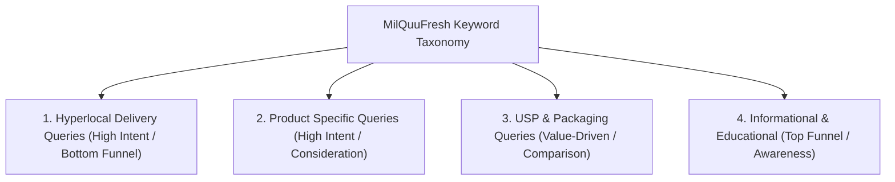

# MilQuuFresh — SEO Keyword Strategy & Search Architecture

**Brand:** MilQuuFresh  
**Primary Target Market:** Navi Mumbai (Panvel, New Panvel, Karanjade, Kharghar, CBD Belapur, Nerul, Kamothe, Taloja)  
**Core Offerings:** A2 Gir Cow Milk, Fresh Cow Milk, Buffalo Milk, Desi Ghee, Fresh Malai Paneer  
**Differentiator:** Morning delivery before 7:00 AM in returnable, sterilized glass bottles.

---

## 1. Keyword Taxonomy & Intent Framework

Search queries in the dairy delivery niche fall into four primary categories:

### Search Intent Mapping:
1. **Transactional / High Commercial Intent (Bottom Funnel):** Customers looking for immediate doorstep milk subscriptions in their sector/locality. Targeted by Location Landing Pages and the Subscription Page.
2. **Commercial Investigation (Mid Funnel):** Customers comparing milk types (A2 vs Regular, Cow vs Buffalo) or seeking glass-bottled dairy. Targeted by Product Pages and the Glass Bottle page.
3. **Informational / Discovery (Top Funnel):** Customers researching health benefits, traditional bilona ghee, or purity tests. Targeted by the Dairy Blog.

---

## 2. Core Keyword Clusters & Target URLs

### Cluster A: A2 Gir Cow Milk
- **Target URL:** `/product/farm-fresh-cow-milk`
- **Primary Keywords:**
  - `A2 cow milk delivery Navi Mumbai` (High Commercial)
  - `A2 Gir cow milk subscription` (High Commercial)
  - `buy A2 milk in Panvel / Kharghar` (Hyperlocal)
  - `pure Gir cow milk in glass bottle` (USP Focus)
- **Secondary / Long-Tail:**
  - `A2 beta casein milk benefits`
  - `desi cow milk near me Navi Mumbai`
  - `A2 cow milk price per litre Navi Mumbai`
- **On-Page Optimization:** H1 = `A2 Gir Cow Milk`, Product Schema with dynamic price, FAQs on Gir cow breed, A2 protein explanation, glass bottle return policy.

---

### Cluster B: Buffalo Milk (Full Cream / Chai & Curd)
- **Target URL:** `/product/pure-buffalo-milk`
- **Primary Keywords:**
  - `buffalo milk delivery Navi Mumbai` (High Commercial)
  - `fresh buffalo milk in glass bottle` (High Commercial)
  - `full cream buffalo milk subscription` (High Commercial)
  - `thick buffalo milk for tea and curd` (Intent Focus)
- **Secondary / Long-Tail:**
  - `Murrah buffalo milk online delivery`
  - `pure buffalo milk Panvel / Nerul`
  - `unadulterated buffalo milk fat content`
- **On-Page Optimization:** H1 = `Buffalo Milk`, high-fat/SNF operational facts (6.5% fat), emphasis on thick texture for homemade curd and sweets.

---

### Cluster C: Fresh Cow Milk (Everyday Pouch Option)
- **Target URL:** `/product/cow-milk-pouch`
- **Primary Keywords:**
  - `fresh cow milk delivery Navi Mumbai`
  - `daily cow milk pouch subscription`
  - `affordable fresh milk delivery Panvel`
- **Secondary / Long-Tail:**
  - `morning milk pouch delivery before 7 am`
  - `pure cow milk subscription Kharghar`

---

### Cluster D: Pure Bilona Desi Ghee
- **Target URL:** `/product/desi-cow-ghee`
- **Primary Keywords:**
  - `bilona desi ghee Navi Mumbai`
  - `buy A2 cow ghee online Panvel`
  - `traditional bilona method ghee`
  - `pure desi cow ghee in glass jar`
- **Secondary / Long-Tail:**
  - `Vedic bilona churned ghee`
  - `aromatic grass-fed cow ghee`
  - `danedar desi ghee delivery`

---

### Cluster E: Fresh Malai Paneer
- **Target URL:** `/product/fresh-paneer`
- **Primary Keywords:**
  - `fresh malai paneer delivery Navi Mumbai`
  - `soft paneer online Panvel / Kharghar`
  - `unprocessed chemical free paneer`
- **Secondary / Long-Tail:**
  - `daily morning paneer delivery`
  - `fresh dairy paneer near me`

---

### Cluster F: Glass Bottle Milk Delivery (Differentiator)
- **Target URL:** `/glass-bottle-milk-delivery`
- **Primary Keywords:**
  - `glass bottle milk delivery Navi Mumbai`
  - `plastic free milk delivery Panvel / Kharghar`
  - `fresh milk in returnable glass bottles`
  - `eco friendly milk delivery service`
- **Secondary / Long-Tail:**
  - `advantages of glass bottled milk over plastic pouches`
  - `chemical leaching plastic milk pouches`
  - `sustainable morning dairy subscription`

---

## 3. Hyperlocal Geo-Targeted Search Matrix

| Service Area (Navi Mumbai) | Target Landing Page | Priority Local Keywords |
| :--- | :--- | :--- |
| **Regional Hub** | `/milk-delivery-navi-mumbai` | `milk delivery navi mumbai`, `daily milk subscription navi mumbai`, `fresh dairy delivery navi mumbai` |
| **Panvel** | `/milk-delivery-panvel` | `milk delivery panvel`, `A2 cow milk delivery panvel`, `fresh milk subscription in panvel` |
| **New Panvel** | `/milk-delivery-new-panvel` | `milk delivery new panvel`, `morning milk round new panvel`, `buffalo milk delivery new panvel` |
| **Karanjade** | `/milk-delivery-karanjade` | `milk delivery karanjade`, `fresh dairy delivery in karanjade`, `pure cow milk karanjade` |
| **Kharghar** | `/organic-milk-kharghar` | `milk delivery kharghar`, `A2 milk in kharghar`, `pure cow milk delivery kharghar sector 1 to 35` |
| **CBD Belapur** | `/fresh-cow-milk-belapur` | `milk delivery cbd belapur`, `fresh cow milk belapur`, `dairy delivery belapur sector 15` |
| **Nerul** | `/farm-fresh-milk-nerul` | `milk delivery nerul`, `farm fresh milk nerul`, `daily milk subscription in nerul west east` |
| **Kamothe** *(Integrated in Hub & Products)* | `/milk-delivery-navi-mumbai#kamothe` | `milk delivery kamothe`, `A2 milk delivery in kamothe`, `morning milk subscription kamothe` |
| **Taloja** *(Integrated in Hub & Products)* | `/milk-delivery-navi-mumbai#taloja` | `milk delivery taloja`, `fresh milk delivery taloja phase 1 2`, `dairy subscription taloja` |

---

## 4. Competitor Organic Landscape & Tactical Positioning

| Competitor | Strengths | Weaknesses / Gaps | MilQuuFresh Strategic Counter |
| :--- | :--- | :--- | :--- |
| **Country Delight** | High brand awareness, aggressive paid marketing, broad delivery. | Packaged largely in plastic pouches, perceived as mass commercial, inconsistent morning delivery times in local pockets. | Position as the **local, farm-fresh glass-bottle specialist** with verified delivery before 7:00 AM across Navi Mumbai. |
| **Akshayakalpa** | Strong organic certification, premium organic positioning. | Premium pricing, limited local availability in New Panvel / Karanjade / Taloja, carton packaging. | Highlight competitive pricing, traditional bilona process, local Navi Mumbai customer service, and direct returnable glass bottles. |
| **Local Milkman / Dairies** | Deep local relationships, flexible billing. | Unverified cold chains, loose packaging, zero digital subscription controls, adulteration risks. | Emphasize lab testing, hygiene, smartphone app control (pause/resume anytime), and strict tamper-evident seals. |

---

## 5. Ongoing Keyword Tracking & KPIs

1. **Top 3 Rankings for Core Local Keywords:**
   - `milk delivery panvel`
   - `milk delivery kharghar`
   - `glass bottle milk delivery navi mumbai`
   - `A2 cow milk delivery navi mumbai`
2. **Organic Click-Through Rate (CTR) Benchmark:**
   - Branded queries: > 35%
   - Local transactional queries: > 8%
3. **Organic Conversion Rate:**
   - Visitor-to-WhatsApp Inquiry: > 4.5%
   - Visitor-to-Subscription Activation: > 2.0%
